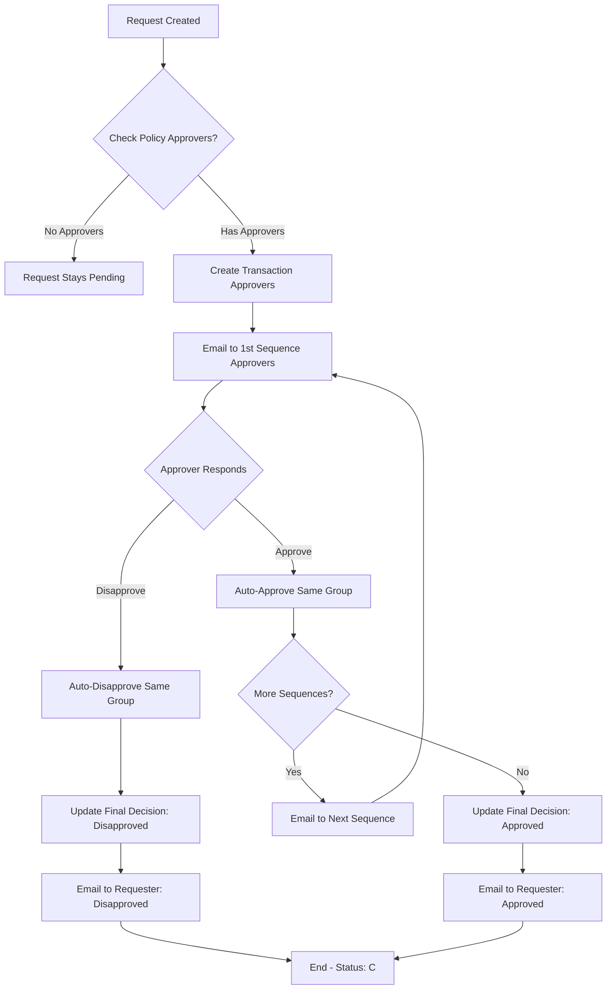
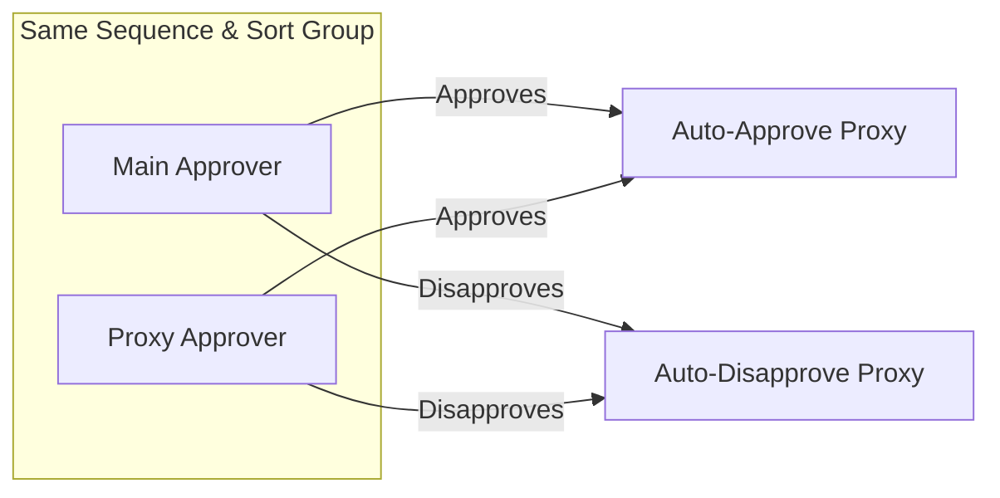

# EPE Approval & Notification Process Flow

## Overview

The EPE (Exemption/Policy Exception) system implements a **multi-level sequential approval workflow** with automatic progression and email notifications. This document describes the complete approval and notification process.

---

## Current Approver Configuration

### Example Scenario (From User)

| Approver | LineSequence | Sort | Role |
|----------|--------------|------|------|
| Approver 1 | 1 | 1 | Main (Sort 1) |
| Approver 2 | 1 | 2 | Main (Sort 2) |
| Approver 3 | 2 | 2 | Proxy of Approver 2 |
| Approver 4 | 1 | 3 | Main (Sort 3) |

### How LineSequence and Sort Work

- **LineSequence** = Approval Stage/Level (hierarchy)
  - Stage 1, Stage 2, Stage 3, etc.
  - Must complete all approvers at current stage before moving to next
- **Sort** = Approver sequence within that stage
  - Sort 1 = First approver
  - Sort 2 = Second approver / Proxy
  - Sort 3 = Third approver, etc.

### Correct Flow

1. **Stage 1 (LineSequence=1), Sort 1**: Approver 1 approves → auto-approves self, proceeds to LineSequence=2, Sort 1
2. **Stage 1 (LineSequence=1), Sort 2**: Approver 2 approves → auto-approves self AND Approver 3 (proxy at Seq=2), proceeds to next
3. **Stage 1 (LineSequence=1), Sort 3**: Approver 4 approves → auto-approves self, proceeds to next (if exists)

### Bug Fix Applied

**Previous (Incorrect) Logic:**
```csharp
// Only checked same LineSequence AND Sort (group)
var approversInGroup = allApprovers
    .Where(a => a.Sort == currentSort && a.Linesequence == currentSequence)
    .ToList();
```

**Current (Fixed) Logic:**
```csharp
// Approvers with same Sort are a group (main + proxy)
// If one approves, all with same Sort are auto-approved, including proxy at next sequence
var approversInGroup = allApprovers
    .Where(a => a.Sort == currentSort && a.Linesequence == currentSequence)
    .ToList();

// Auto-approve proxy at next sequence with same Sort
var proxyInNextSequence = allApprovers
    .Where(a => a.Sort == currentSort && a.Linesequence == currentSequence + 1)
    .ToList();

// Only proceed to next sequence when group approves
var hasApprovedInGroup = allGroupsToAutoApprove.Any(a => a.Respond == 1);
```

---

## Process Flow Diagram

### Main Approval Workflow



### Approver Group Logic



---

## Approval Workflow Steps

### 1. Create Exemption Request

**Endpoint:** `POST /api/exception/create`

| Step | Action | Description |
|------|--------|-------------|
| 1.1 | Validate Input | Receive `EpeTransactionheader` object |
| 1.2 | Set Defaults | Corporate, Status: "Pending", FinalDecision: "Pending" |
| 1.3 | Capture Metadata | IP Address, MAC Address, CreatedDate |
| 1.4 | Save Header | Insert transaction header to database |
| 1.5 | Fetch Policy Approvers | Get approvers from `EpePolicyapprovers` based on PolicyId |
| 1.6 | Create Transaction Approvers | Create approver records in `EpeTransactionapprovers` |
| 1.7 | Get First Sequence | Find minimum LineSequence from policy approvers |
| 1.8 | Send Email | Notify first sequence approvers via email |
| 1.9 | Commit Transaction | Save all changes to database |

### 2. Approver Responds to Request

**Endpoint:** `POST /api/exception/respond`

**Request Body:**
```csharp
{
    TransactionId: long,
    TransApproverId: long,
    EmployeeId: string?,
    Remarks: string?,
    Respond: int  // 1 = Approved, 2 = Disapproved
}
```

#### If Approve (Respond = 1)

| Step | Action | Description |
|------|--------|-------------|
| 2.1 | Update Approver | Set Respond=1, RespondDate, Remarks |
| 2.2 | Auto-Approve Group | Find all approvers with same LineSequence & Sort |
| 2.3 | Check Approval | If either main or proxy approved, auto-approve others |
| 2.4 | Check Next Sequence | Find if there are more approvers (LineSequence > current) |
| 2.5 | Notify Next | If more sequences, send email to next approvers |
| 2.6 | Complete All | If no more sequences, mark as Approved (Status: C) |
| 2.7 | Email Requester | Send approval notification to requester |

#### If Disapprove (Respond = 2)

| Step | Action | Description |
|------|--------|-------------|
| 2.1 | Update Approver | Set Respond=2, RespondDate, Remarks |
| 2.2 | Auto-Disapprove Group | Auto-disapprove all in same group |
| 2.3 | Update Final Decision | Set FinalDecision = "Disapproved", Status = "C" |
| 2.4 | Email Requester | Send disapproval notification to requester |

### 3. Resend Approval Email

**Endpoint:** `POST /api/exception/resend/{id}`

| Step | Action | Description |
|------|--------|-------------|
| 3.1 | Get Approver | Fetch approver record by TransApproverId |
| 3.2 | Get Transaction | Fetch transaction header |
| 3.3 | Determine Email | If IM type, get immediate manager email; otherwise use stored |
| 3.4 | Send Email | Resend approval request email |
| 3.5 | Update Tracking | Increment SentCount, update LastSentDate |

---

## Notification Process

### Email Notifications Sent

| Trigger | Recipient | Email Type |
|---------|-----------|------------|
| Request Created | First Sequence Approvers | Approval Request |
| Request Approved (next sequence) | Next Sequence Approvers | Approval Request |
| Request Fully Approved | Requester | Status Changed (Approved) |
| Request Disapproved | Requester | Status Changed (Disapproved) |
| Manual Resend | Specific Approver | Approval Request |

### Email Service Methods

```csharp
// Send approval request to approver
await _emailService.SendApprovalRequestEmailAsync(
    approverEmail,        // Recipient
    transactionId,         // Transaction ID
    transactionNumber,     // Transaction Number
    requesterName,        // Requester Name
    details               // Request Details
);

// Notify requester of status change
await _emailService.SendStatusChangedEmailAsync(
    requesterEmail,       // Recipient
    transactionNumber,   // Transaction Number
    previousStatus,      // e.g., "Pending"
    newStatus,           // e.g., "Approved"
    approverName         // Who changed it (or "System")
);
```

---

## Data Models

### Transaction Header Status

| Field | Values | Description |
|-------|--------|-------------|
| Status | P | Pending (initial) |
| Status | C | Completed (approved/disapproved) |
| FinalDecision | Pending | Not yet decided |
| FinalDecision | Approved | All approvers approved |
| FinalDecision | Disapproved | Any approver disapproved |

### Approver Fields

| Field | Description |
|-------|-------------|
| LineSequence | Order of approval (1, 2, 3...) |
| Sort | Main (1) or Proxy (2) within same sequence |
| Respond | 0 = No response, 1 = Approved, 2 = Disapproved |
| ApproverType | IM = Immediate Manager, or specific approver |
| IsSent | Whether email notification was sent |

### Approver Types

- **IM (Immediate Manager):** The requester's direct supervisor (from employee details)
- **Direct:** Specific employee configured as policy approver

---

## Auto-Approval Logic

### Group Approval

When any approver in a group (same LineSequence and Sort) responds:
1. **If Approved:** Auto-approve all other unresponded approvers in the same group
2. **If Disapproved:** Auto-disapprove all other unresponded approvers in the same group

### Sequential Progression

- Each LineSequence must be fully satisfied before moving to next
- Within a sequence, if either Main (Sort=1) or Proxy (Sort=2) approves, next sequence is triggered
- Final decision is only set when ALL sequences are completed

---

## API Endpoints Summary

| Method | Endpoint | Purpose |
|--------|----------|---------|
| POST | `/api/exception` | List exemption requests (paginated) |
| POST | `/api/exception/edit/{id}` | Get request with approvers for editing |
| POST | `/api/exception/view/{id}` | Get request with approvers (read-only) |
| POST | `/api/exception/create` | Create new exemption request |
| POST | `/api/exception/update/{id}` | Update exemption request |
| POST | `/api/exception/delete/{id}` | Soft delete request |
| POST | `/api/exception/respond` | Submit approver response |
| POST | `/api/exception/resend/{id}` | Resend email to approver |

---

## Error Handling

- All database operations wrapped in transactions
- Email failures logged but don't fail the request
- Returns appropriate HTTP status codes (200, 400, 404, 500)
- Success response includes `{ success: true, ... }`

---

## Flow Summary

1. **Request Created** → First approvers notified via email
2. **Approver Responds** → Update response, auto-handle group, proceed to next or complete
3. **All Approved** → Requester notified of approval
4. **Any Disapproved** → Requester notified of disapproval, process ends