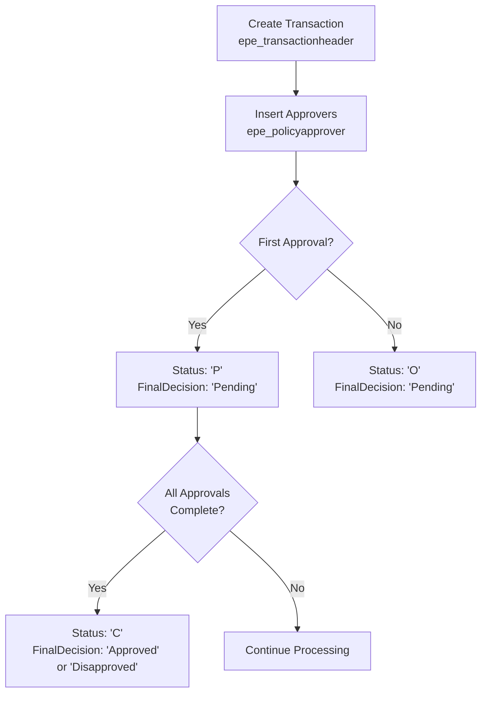

# Approval Workflow Guide

## Overview

This guide documents the TypeScript interfaces and workflow for the approval system, covering the [`epe_transactionheader`](EPEUI/plans/approval-workflow-guide.md) and [`epe_policyapprover`](EPEUI/plans/approval-workflow-guide.md) tables.

---

## TypeScript Interfaces

### epe_transactionheader

```typescript
// Transaction Status Enum
type TransactionStatus = 'O' | 'P' | 'C'

// Final Decision Enum
type FinalDecision = 'Pending' | 'Approved' | 'Disapproved'

// Transaction Header Interface
interface EpeTransactionHeader {
  id: string
  transactionNumber: string
  status: TransactionStatus
  finalDecision: FinalDecision
  createdBy: string
  createdAt: Date
  updatedAt: Date
  // Add other relevant fields
}
```

#### Status Values

| Status Code | Description | Final Decision |
|-------------|-------------|----------------|
| `'O'` | Open - New transaction, no approvals yet | `'Pending'` |
| `'P'` | Pending - At least one approval made | `'Pending'` |
| `'C'` | Complete - All approvals done | `'Approved'` or `'Disapproved'` |

---

### epe_policyapprover

```typescript
// Approver Type Enum
type ApproverType = 'IM' | 'M'

// Policy Approver Interface
interface EpePolicyApprover {
  id: string
  transactionHeaderId: string
  approverType: ApproverType
  approverEmployeeId: string
  approverName: string
  sort: number
  lineSequence: number
  isActive: boolean
  createdAt: Date
  updatedAt: Date
}
```

#### ApproverType Values

| Code | Description |
|------|-------------|
| `'IM'` | ImmediateHead - Gets ImmediateHead from HRIS |
| `'M'` | Main Approver |

#### Line Sequence Values

| Sequence | Description |
|----------|-------------|
| `1` | Main Approver |
| `2+` | Proxy Approver |

**Example:** Marydelle is Proxy to Yokai since they have the same sort number, but Marydelle's line sequence is `2`.

---

## Approval Workflow Process



---

## BaseTable Usage Examples

### Displaying Transactions with Status Badges

```vue
<template>
  <BaseTable
    :table-data="transactions"
    :header="['transactionNumber', 'status', 'finalDecision', 'createdAt']"
    :badge-fields="['status', 'finalDecision']"
    :field-mappings="{
      status: {
        'O': 'Open',
        'P': 'Pending Approval',
        'C': 'Completed'
      },
      finalDecision: {
        'Pending': 'Pending',
        'Approved': 'Approved',
        'Disapproved': 'Disapproved'
      }
    }"
    :field-colors="{
      status: {
        'O': 'bg-blue-100 text-blue-800',
        'P': 'bg-yellow-100 text-yellow-800',
        'C': 'bg-green-100 text-green-800'
      },
      finalDecision: {
        'Pending': 'bg-yellow-100 text-yellow-800',
        'Approved': 'bg-green-100 text-green-800',
        'Disapproved': 'bg-red-100 text-red-800'
      }
    }"
    :date-fields="['createdAt']"
    :pagination="true"
    :per-page="10"
  />
</template>

<script setup lang="ts">
import type { EpeTransactionHeader } from '~/types/approval'

const transactions = ref<EpeTransactionHeader[]>([])
</script>
```

---

### Displaying Approvers with Type Indicators

```vue
<template>
  <BaseTable
    :table-data="approvers"
    :header="['approverName', 'approverType', 'sort', 'lineSequence']"
    :badge-fields="['approverType']"
    :field-mappings="{
      approverType: {
        'IM': 'Immediate Head',
        'M': 'Main Approver'
      }
    }"
    :field-colors="{
      approverType: {
        'IM': 'bg-purple-100 text-purple-800',
        'M': 'bg-indigo-100 text-indigo-800'
      }
    }"
    :sortable-columns="['approverName', 'sort', 'lineSequence']"
  />
</template>

<script setup lang="ts">
import type { EpePolicyApprover } from '~/types/approval'

const approvers = ref<EpePolicyApprover[]>([])
</script>
```

---

## Complete Type Definition File

```typescript
// types/approval.ts

// ===========================================
// Enums
// ===========================================

/**
 * Transaction status codes
 * - 'O': Open - New transaction, no approvals yet
 * - 'P': Pending - At least one approval made
 * - 'C': Complete - All approvals done
 */
export type TransactionStatus = 'O' | 'P' | 'C'

/**
 * Final decision after all approvals
 */
export type FinalDecision = 'Pending' | 'Approved' | 'Disapproved'

/**
 * Approver type codes
 * - 'IM': ImmediateHead - Retrieved from HRIS
 * - 'M': Main Approver
 */
export type ApproverType = 'IM' | 'M'

// ===========================================
// Interfaces
// ===========================================

/**
 * Transaction header - represents a single transaction/request
 */
export interface EpeTransactionHeader {
  id: string
  transactionNumber: string
  status: TransactionStatus
  finalDecision: FinalDecision
  createdBy: string
  createdAt: Date
  updatedAt: Date
  // Add other fields as needed based on your business logic
}

/**
 * Policy approver - represents an approver for a transaction
 */
export interface EpePolicyApprover {
  id: string
  transactionHeaderId: string
  approverType: ApproverType
  approverEmployeeId: string
  approverName: string
  sort: number
  lineSequence: number
  isActive: boolean
  createdAt: Date
  updatedAt: Date
}

// ===========================================
// Helper Functions
// ===========================================

/**
 * Get display text for transaction status
 */
export function getStatusDisplay(status: TransactionStatus): string {
  const statusMap: Record<TransactionStatus, string> = {
    'O': 'Open',
    'P': 'Pending Approval',
    'C': 'Completed'
  }
  return statusMap[status]
}

/**
 * Get display text for approver type
 */
export function getApproverTypeDisplay(type: ApproverType): string {
  const typeMap: Record<ApproverType, string> = {
    'IM': 'Immediate Head',
    'M': 'Main Approver'
  }
  return typeMap[type]
}

/**
 * Check if approver is a proxy (lineSequence > 1)
 */
export function isProxyApprover(approver: EpePolicyApprover): boolean {
  return approver.lineSequence > 1
}

/**
 * Check if approver is main approver (lineSequence === 1)
 */
export function isMainApprover(approver: EpePolicyApprover): boolean {
  return approver.lineSequence === 1
}

/**
 * Check if transaction is complete
 */
export function isTransactionComplete(header: EpeTransactionHeader): boolean {
  return header.status === 'C'
}

/**
 * Check if transaction is pending (has at least one approval)
 */
export function isTransactionPending(header: EpeTransactionHeader): boolean {
  return header.status === 'P'
}

/**
 * Check if transaction is open (no approvals yet)
 */
export function isTransactionOpen(header: EpeTransactionHeader): boolean {
  return header.status === 'O'
}

// ===========================================
// API Response Types
// ===========================================

export interface TransactionWithApprovers extends EpeTransactionHeader {
  approvers: EpePolicyApprover[]
}

export interface CreateTransactionRequest {
  // Define the fields needed to create a new transaction
  [key: string]: any
}

export interface ApproveTransactionRequest {
  transactionId: string
  approverEmployeeId: string
  decision: 'Approved' | 'Disapproved'
  comments?: string
}
```

---

## Workflow Summary

1. **Transaction Creation**: When a new transaction is created in [`epe_transactionheader`](EPEUI/plans/approval-workflow-guide.md), it starts with:
   - Status: `'O'` (Open)
   - FinalDecision: `'Pending'`

2. **Approver Assignment**: Upon transaction creation, the system also inserts the list of approvers into [`epe_policyapprover`](EPEUI/plans/approval-workflow-guide.md)

3. **Approval Process**: 
   - When any approver makes a decision, status changes to `'P'` (Pending)
   - FinalDecision remains `'Pending'`

4. **Completion**: 
   - When all approvers have approved/disapproved, status changes to `'C'` (Complete)
   - FinalDecision becomes either `'Approved'` or `'Disapproved'`

---

## Related Files

- [`BaseTable`](app/components/BaseTable.vue) - Table component for displaying data
- [`approval.ts`](types/approval.ts) - TypeScript type definitions
