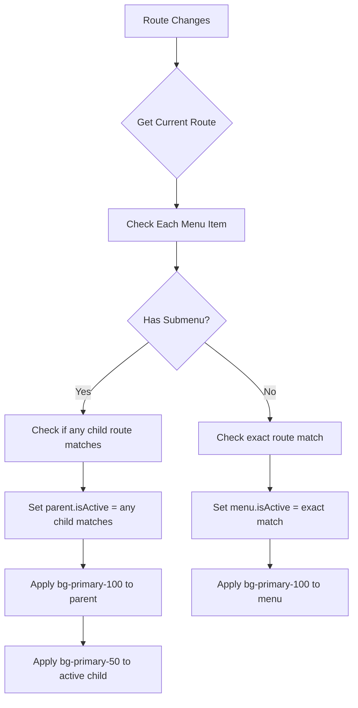

# Sidebar Active State Detection - Analysis & Customization Plan

## How It Currently Works

### 1. Core Detection Function (`updateActiveStates`)

Located in [`SidebarItems.vue`](app/dashboard/sidebar/SidebarItems.vue:155-167):

```javascript
const updateActiveStates = (path) => {
  menulist.value.forEach((menu) => {
    menu.isActive = false;
    menu.isopen = false;
    
    if (menu.submenu) {
      // For dropdown menus
      menu.submenu.forEach((sub) => (sub.isclick = path === sub.route));
      menu.isopen = sidebarOpen.value && menu.submenu.some((s) => s.isclick);
      menu.isActive = menu.isopen;  // Parent becomes active when any submenu is active
    } else {
      // For direct menu items
      menu.isActive = path === menu.route;
    }
  });
};
```

**How it works:**
- Uses **exact route matching** (`path === menu.route`)
- For dropdowns: Sets parent `isActive = true` when ANY child is active
- For direct menus: Sets `isActive = true` only when route exactly matches

### 2. When It's Called

Three trigger points in [`SidebarItems.vue`](app/dashboard/sidebar/SidebarItems.vue:245-251):

```javascript
// 1. On initial load
updateActiveStates(route.path);

// 2. After every route change
router.afterEach((to) => updateActiveStates(to.path));

// 3. When sidebar opens/closes
watch(sidebarOpen, (newVal) => {
  if (!newVal) menulist.value.forEach((m) => (m.isopen = false));
  else updateActiveStates(route.path);
});
```

### 3. How Styling Is Applied

In the template [`SidebarItems.vue`](app/dashboard/sidebar/SidebarItems.vue:328-332):

```vue
<!-- Parent Menu -->
<button
  :class="[
    item.isActive
      ? 'bg-primary-100 text-primary-700 font-semibold'
      : 'text-gray-700 hover:bg-gray-100 hover:text-gray-900',
  ]"
>

<!-- Submenu Item -->
<button
  :class="[
    sub.isclick
      ? 'bg-primary-50 text-primary-600 font-medium'
      : 'text-gray-700 hover:bg-gray-100 hover:text-gray-900',
  ]"
>
```

---

## Current Limitations

1. **Exact match only** - Won't match `/exemptions/create` when route is `/exemptions`
2. **Case sensitive** - Won't handle trailing slashes or variations
3. **No nested submenu support** - Only one level of dropdown

---

## Customization Options

### Option 1: Add Partial Match Support

Change exact match to check if route **starts with** the menu path:

```javascript
// Instead of: path === menu.route
// Use: path.startsWith(menu.route) or path.startsWith(menu.route + '/')

menu.isActive = path.startsWith(menu.route + '/') || path === menu.route;
```

### Option 2: Add Parent Matching for Dropdowns

If you want the parent dropdown to highlight when child is active (already implemented):

```javascript
menu.isActive = menu.submenu.some((s) => s.isclick);
```

### Option 3: Add Custom Active Path per Menu Item

Add an `activePath` property to menu items for custom matching:

```javascript
// Menu data
{
  id: 3,
  title: "Exemptions",
  route: "/exemptions",
  activePath: "/exemptions",  // Custom path to match
  submenu: [...]
}

// Detection logic
menu.isActive = path.startsWith((menu.activePath || menu.route) + '/');
```

### Option 4: Add Base Path Matching

Match by the first segment of the route:

```javascript
const getBasePath = (path) => '/' + path.split('/')[1];

// Compare base paths
menu.isActive = getBasePath(path) === getBasePath(menu.route);
```

---

## Recommended Implementation

Based on your requirements, here's the recommended approach:



---

## Implementation Checklist

- [ ] Modify `updateActiveStates()` to use partial matching
- [ ] Add support for `activePath` property in menu data
- [ ] Update static menu definitions with proper routes
- [ ] Test with nested routes
- [ ] Verify dropdown parent highlighting works

---

## File Locations

| File | Purpose |
|------|---------|
| [`app/dashboard/sidebar/SidebarItems.vue`](app/dashboard/sidebar/SidebarItems.vue) | Main menu component with active state logic |
| [`app/services/menuService.js`](app/services/menuService.js) | API menu fetching and mapping |
| [`app/dashboard/store.ts`](app/dashboard/store.ts) | Sidebar state management |
